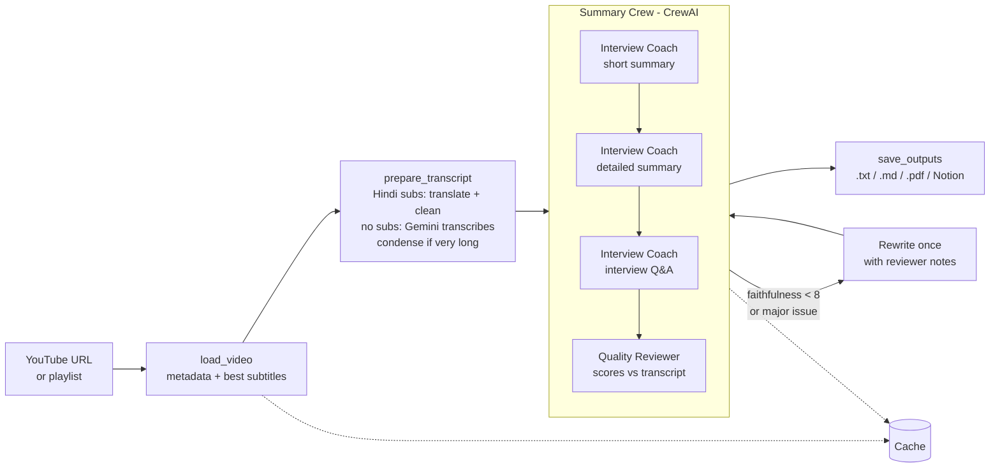

# Interview Prep Agent

Turn any YouTube video, or a whole playlist, into **interview-ready study notes**. An AI *Senior Interview Coach*, built with [CrewAI](https://crewai.com), reads the video's English subtitles and writes:

| File | What's in it |
|---|---|
| `<Title> - Short Summary.txt` | A 2-minute read: what it is, 5–7 key points, one line to say in the interview |
| `<Title> - Detailed Summary.txt` | A full study guide: sections, examples, trade-offs, common mistakes, related points the video doesn't cover, and a recap |
| `<Title> - Interview Q&A.txt` | 10–15 likely interview questions (easy → hard) with model answers and follow-ups |
| `<Title> - Study Guide.pdf` | All three in a formatted PDF with clickable timestamps |
| `Quality Review.md` + `metadata.json` | The AI reviewer's scores, token usage, and run details |

Every key point carries a **timestamp** (`[03:15]`). In the Markdown, PDF and Notion versions, the timestamp is a link that opens the video at that moment.

## How it works



* **Plain Python does the predictable work.** Fetching subtitles, naming folders and writing files never go through the LLM, so they are fast, free and reliable.
* **Structured outputs.** Agents return typed Pydantic objects, not free text, and our renderer formats them. Every file has the same clean layout.
* **Built-in quality gate.** A second agent checks every claim against the transcript. If it finds a factual error, the coach rewrites the pack using the reviewer's notes. The scores are saved with each result.
* **Caching.** Subtitles and generated packs are cached in `.cache/`. Re-running a video costs nothing. Changing the model or prompts automatically invalidates the cache.

## Hindi videos and videos without subtitles

Many tech videos are narrated in Hindi or Hinglish and only have **auto-generated Hindi subtitles**. They're written in Devanagari, have no punctuation, and are full of mis-heard words ("रम" for RAM, "रेप्स" for replicas). The agent picks the best text it can find:

| The video has… | What happens |
|---|---|
| English subtitles | Used as-is (human-written ones are preferred over auto-generated) |
| Only Hindi (or other) subtitles | The LLM translates them to English **and cleans them up**. Using the title and description as context, it fixes mis-heard technical terms, applies the speaker's own corrections, and drops filler. Timestamps are kept. |
| No subtitles at all | Gemini watches the video straight from its URL (nothing is downloaded) and writes a clean English transcript with timestamps |

The English transcript the agents worked from is saved next to the summaries as `<Title> - Transcript (English).txt`. Translations are cached, so you pay for them only once per video. The coach and reviewer are told when a transcript was translated, so the reviewer doesn't penalise correctly fixed terms.

Choose the languages with `SUBTITLE_LANGUAGES` (default `hi`) or `--languages hi,mr`. To skip videos without subtitles instead of transcribing them, use `--no-transcribe`.

## Quick start

Requires [uv](https://docs.astral.sh/uv/) (it installs Python 3.12 for you).

```bash
uv sync
cp .env.example .env        # then add your GEMINI_API_KEY
```

### Web UI

```bash
uv run interview-prep ui
```

Paste URLs, click **Generate**, and read the results in tabs or download them. The **Library** tab lists everything you have generated before.

### Command line

```bash
# One or more videos
uv run interview-prep https://www.youtube.com/watch?v=VIDEO_ID

# A whole playlist (one folder per video + a combined study guide)
uv run interview-prep "https://www.youtube.com/playlist?list=PLAYLIST_ID"

# Group unrelated videos into one course folder
uv run interview-prep URL1 URL2 URL3 --group "System Design Prep"

# URLs from a file, first 5 videos per playlist, also publish to Notion
uv run interview-prep -f urls.txt --limit 5 --export md,pdf,notion
```

| Option | Meaning |
|---|---|
| `--force` | Ignore the cache and regenerate |
| `--group NAME` | Put all given videos in one folder with a combined guide |
| `--whole-playlist` | For a `watch?v=…&list=…` link, process the whole playlist |
| `--limit N` | Only the first N videos of each playlist |
| `--export md,pdf,notion` | Extra formats (`.txt` is always written) |
| `--model` | Override the model, e.g. `anthropic/claude-sonnet-5-5` |
| `--out DIR` | Output folder (default `output/`) |
| `--languages hi,mr` | Subtitle languages to translate when there are no English ones |
| `--no-transcribe` | Skip videos with no subtitles instead of having Gemini transcribe them |
| `-v` | Show the agents' reasoning |

### Output layout

```
output/
├── But what is a neural network/
│   ├── But what is a neural network - Short Summary.txt / .md
│   ├── But what is a neural network - Detailed Summary.txt / .md
│   ├── But what is a neural network - Interview Q&A.txt / .md
│   ├── But what is a neural network - Study Guide.pdf
│   ├── But what is a neural network - Transcript (English).txt
│   ├── Quality Review.md
│   └── metadata.json
└── System Design Course/            ← playlist
    ├── Combined Study Guide.txt / .md / .pdf
    ├── 01 - Caching Explained/
    └── 02 - Load Balancing/
```

## Notion export

1. Create an internal integration at <https://www.notion.so/my-integrations> and copy its token.
2. In Notion, open the page that should hold your notes. Choose **⋯ → Connections** and add the integration.
3. Set `NOTION_TOKEN` and `NOTION_PARENT_PAGE_ID` (the 32-character id at the end of the page URL) in `.env`.
4. Run with `--export md,pdf,notion`, or tick **Publish to Notion** in the UI.

## Docker

```bash
docker build -t interview-prep .
docker run --env-file .env -p 8501:8501 -v "$PWD/output:/app/output" interview-prep
# open http://localhost:8501
```

> **Note:** YouTube often blocks subtitle requests from cloud data-centre IPs. Running locally, or on a server behind a residential proxy, avoids this. The app reports the problem clearly when it happens.

## Configuration

The default model is `gemini/gemini-2.5-flash`. To use another model, set `LLM_MODEL` and the matching API key; any CrewAI-supported provider works.

> **Free-tier limits:** a Gemini free-tier key allows about 20 requests per day for 2.5 Flash. One video uses roughly 6–12 requests: 4 agent tasks, double that if the reviewer asks for a rewrite, plus 1 per ~15 minutes of video for translation or transcription. That's 2–3 videos a day. Everything is cached, so a failed run picks up where it stopped. For more volume, enable billing on the key's Google AI Studio project.

> Google has limited Gemini 2.5 access to existing users and has announced a deprecation, so new API keys may be refused with a "model not available" error. If that happens, set `LLM_MODEL` to a newer Gemini model or to `anthropic/claude-sonnet-5-5`.

All settings live in `.env`. See [.env.example](.env.example) for the full list: model, output and cache folders, export formats, the quality-gate threshold, long-video chunking, and Notion.

## Development

```bash
uv run pytest                    # 51 tests; YouTube and the LLM are faked, no API key needed
uvx ruff@0.14.0 check src tests  # lint
```

CI runs lint and tests on Ubuntu and Windows, then builds the Docker image ([.github/workflows/ci.yml](.github/workflows/ci.yml)).

### Project structure

```
src/interview_prep/
├── flow.py            CrewAI Flow: load → prepare → generate → save
├── crew/              The crew: agents.yaml, tasks.yaml, summary_crew.py
├── models.py          Pydantic schemas for every agent output
├── youtube.py         URL parsing, subtitles, metadata, playlists (no LLM)
├── translate.py       Hindi/other subtitles → clean English (LLM)
├── transcribe.py      No subtitles → Gemini transcribes the video
├── render.py          Pack → .txt / .md documents
├── exporters.py       PDF and Notion
├── pipeline.py        Batches, playlists, combined study guides
├── cache.py           On-disk cache
├── storage.py         Safe file names, atomic writes
├── cli.py / app.py    Command line and Streamlit UI
└── config.py          Settings from environment / .env
```
